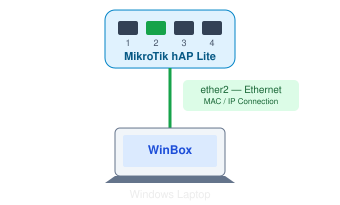

<div align="center">

# Connecting to RouterOS Using WinBox

*Chapter A — MikroTik Fundamentals | Topic A.02*

  

[Overview](#overview) · [Theory](#theory) · [Method A — WinBox](#method-a--winbox-gui) · [Method B — CLI](#method-b--cli) · [Verification](#verification) · [Quick Recap](#quick-recap) · [References](#references)

</div>

> [!NOTE]
> **Draft.** Screenshots and lab results are not recorded yet. Every `TODO` below must be replaced with real lab evidence before publishing.

## Overview

Before a router can be configured, we need a way to reach it. This topic connects a laptop to a MikroTik hAP lite, logs in with WinBox, and opens the RouterOS command line.

After this topic you can:

- Connect a computer to the correct router port.
- Find the router in WinBox and log in by MAC address or IP address.
- Open the RouterOS CLI and run read-only commands.

## Why This Matters

Every later topic starts with "log in to the router". If we cannot log in, we cannot configure anything. Knowing two ways in (MAC and IP) also matters for recovery: MikroTik documents MAC access for the first setup of a new router and for recovering a router whose IP settings are wrong or missing. [3]

## Prerequisites

| Topic | Why it is needed |
| --- | --- |
| [A.01 — Introduction to MikroTik](../01-introduction-to-mikrotik/README.md) | Explains what RouterOS, WinBox, and the CLI are. |

## Theory

### Which port to use

The official First Time Configuration guide says to connect the computer to any Ethernet port **except ether1**, and to connect the ISP cable to ether1. After powering on, wait about one minute for the router to boot. [1]

On devices with a default configuration, ether1 is the WAN port with a DHCP client and firewall, while the other Ethernet ports are in the LAN bridge with the address `192.168.88.1/24`. [5] Plugging the laptop into ether1 would put it on the WAN side.

### Two ways WinBox can connect

| | IP connection | MAC connection |
| --- | --- | --- |
| How it works | WinBox connects to the router's `winbox` service on **TCP port 8291**. [2] | MAC WinBox works at layer 2 using the router's MAC address, carried as UDP port 20561 inside Ethernet frames. [3] |
| Needs an IP address on the router? | Yes | No |
| Reliability | Preferred | "A MAC session uses network broadcasts and is not 100% reliable." [2] |
| Typical use | Normal daily management | First setup, or recovery when IP settings are wrong or missing. [3] |

The WinBox manual recommends using an IP address whenever possible. [2] The First Time Configuration guide recommends the MAC address when the IP address is unreachable or shows `0.0.0.0`. [1]

### How WinBox finds the router

The WinBox **Neighbors** tab lists routers on the same layer 2 network; selecting one connects to it. [2] This only works when the laptop and router share the same Ethernet segment, which is why the cable must go to a LAN port.

### Default login

Username `admin`. The password is empty, or it is the password printed on the device label, if the device has one. [1]

### The RouterOS CLI

The CLI prompt shows the user, router identity, and current menu path, for example `[admin@MikroTik] >`. Commands are organised in a hierarchy such as `/ip/route/print`; `/` goes to the top level and `..` goes up one level. Pressing **Tab** completes a word and pressing it twice lists the options. **F1** shows help. [4]

**Safe mode** (Ctrl+X or F4) undoes changes made in that session if the session ends abnormally. [4] It is a useful habit before changing anything over a remote connection.

### How it connects

```text
A.01 What RouterOS is ──► A.02 How to log in ──► A.03 CLI basics ──► C. Connect the router to the internet
                               │
                               └── MAC access is the recovery path when IP settings break (used again in A.04 reset)
```

## Lab Environment

| Item | Value |
| --- | --- |
| Device | MikroTik hAP lite (RB941-2nD) |
| RouterOS version | `TODO` (from `/system/resource/print`) |
| WinBox version | `TODO` (WinBox v4) |
| Computer | Lenovo LOQ 15IAX9, Windows 11 |
| Connection | Laptop Ethernet ↔ hAP lite **ether2** |



## Method A — WinBox (GUI)

### Step 1 — Download WinBox

Download WinBox from the official link `https://mt.lv/winbox`. On Windows it is a ZIP file containing `WinBox.exe`; no installation is needed. [1]

`TODO` 

### Step 2 — Connect the cable

Connect the laptop to **ether2** (any port except ether1) and power on the router. Wait about one minute. [1]

`TODO` photo or screenshot of the link status in Windows: 

### Step 3 — Find the router in Neighbors

Open WinBox and select the **Neighbors** tab. The router should appear with its MAC address, IP address, identity, and RouterOS version. [2]

`TODO` 

### Step 4 — Log in

1. Click the router's **MAC address** (or its IP address if it shows a valid `192.168.88.1`). [1]
2. Login: `admin`. Password: empty, or the password from the device label. [1]
3. Click **Connect**.

`TODO` 

### Step 5 — Check the connection type and router information

Open **System → Resources** to see the RouterOS version and board name.

`TODO` 

## Method B — CLI

The CLI can be reached from WinBox or over SSH. The console is available over serial, Telnet, SSH, or the WinBox terminal. [4]

### Step 1 — Open a terminal from WinBox

Log in with WinBox (Method A, steps 1–4) and click **New Terminal**.

`TODO` 

### Step 2 — Or connect over SSH from Windows

If the router has an IP address you can reach, open PowerShell and run:

```powershell
ssh admin@192.168.88.1
```

> [!WARNING]
> **Source needed:** confirm on the RouterOS [SSH page](https://manual.mikrotik.com/docs/management-tools/ssh/) that the SSH service is enabled by default and listens on port 22.

`TODO` 

### Step 3 — Read router information

These commands only read information; they do not change the configuration.

```routeros
/system/resource/print
/system/identity/print
/ip/address/print
```

| Command | What it shows |
| --- | --- |
| `/system/resource/print` | RouterOS version, board name, uptime, CPU, and memory. |
| `/system/identity/print` | The router's name, shown in the prompt. |
| `/ip/address/print` | IP addresses configured on each interface. |

`TODO` 

### Step 4 — Practise CLI navigation

```routeros
/ip
address
print
..
/
```

Try pressing **Tab** twice after `/ip/` to list the submenus. [4]

`TODO` 

## Verification

| Check | Expected result | Actual result |
| --- | --- | --- |
| Router appears in Neighbors | MAC address and identity listed | `TODO` |
| Login succeeds | WinBox main window opens | `TODO` |
| `/system/resource/print` | Shows `board-name: RB941-2nD` and the RouterOS version | `TODO` |
| `/ip/address/print` | `192.168.88.1/24` on the LAN bridge (default configuration) [5] | `TODO` |

## Troubleshooting

| Symptom | Likely cause | Check / fix |
| --- | --- | --- |
| Router does not appear in Neighbors | Cable in ether1, or not on the same layer 2 segment | Move the cable to ether2–ether4. [1] |
| IP shows `0.0.0.0` or IP login fails | No usable IP on the router, or laptop in a different subnet | Log in with the MAC address. [1] |
| MAC login drops or is unstable | MAC sessions use broadcasts and are not fully reliable [2] | Use the MAC session only to set an IP address, then reconnect by IP. |
| Login rejected with empty password | Device has a password on its label | Use the password printed on the label. [1] |

## Quick Recap

| Item | Value |
| --- | --- |
| Laptop port | Any Ethernet port except ether1 [1] |
| Default LAN address | `192.168.88.1/24` [5] |
| Default user | `admin`, password empty or from the label [1] |
| WinBox over IP | TCP 8291 [2] |
| WinBox over MAC | Layer 2, UDP 20561 in Ethernet frames, for setup and recovery [3] |
| CLI navigation | `/` top level, `..` up, Tab completes, F1 help [4] |
| Safe mode | Ctrl+X or F4 [4] |

## Key Takeaways

- Connect the laptop to a LAN port, not ether1.
- Prefer IP connections; keep MAC connections for first setup and recovery.
- WinBox and the CLI manage the same router; they are two views of one configuration.

## References

1. [RouterOS Manual — First Time Configuration](https://manual.mikrotik.com/docs/getting-started/first-time-configuration)
2. [RouterOS Manual — WinBox](https://manual.mikrotik.com/docs/management-tools/winbox/)
3. [RouterOS Manual — MAC server](https://manual.mikrotik.com/docs/management-tools/mac-server/)
4. [RouterOS Manual — Console](https://manual.mikrotik.com/docs/management-tools/console/)
5. [RouterOS Manual — Default configurations](https://manual.mikrotik.com/docs/getting-started/configuration-management/default-configurations/)

---

**Previous:** [A.01 — Introduction to MikroTik](../01-introduction-to-mikrotik/README.md) · **Next:** A.03 — RouterOS CLI Basics (planned)

[Back to the main learning journal](../../README.md)
