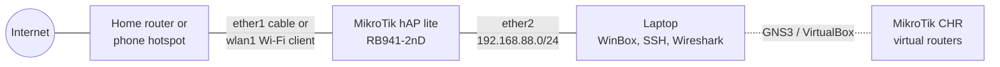

<div align="center">

# RouterOS Field Manual

**Step-by-step MikroTik RouterOS lessons, from first login to VPN and dynamic routing, with every lab shown in both the CLI and WinBox.**


[Start here](#start-here) · [Lab](#lab-environment) · [Roadmap](#learning-roadmap) · [Lesson format](#lesson-format) · [Progress](#learning-progress)

</div>

## Overview

Most MikroTik tutorials show commands without saying why they work, or show WinBox clicks without the CLI behind them. This guide explains each feature from its source (the official RouterOS manual and the IETF RFCs), then configures it twice: once in the CLI and once in WinBox, on a real hAP lite and on virtual routers.

It is written for networking students, MTCNA candidates, IT support technicians, and junior network engineers. Experienced readers can jump to the **Quick Recap** table at the end of each lesson.

The guide started as my own learning journal, so every lesson is checked in my lab before it is marked complete.

## Start here

**What you need**

| Item | Used for |
| --- | --- |
| A MikroTik router with RouterOS v7 (this guide uses a hAP lite RB941-2nD) | Single-router labs (most of chapters A–L) |
| A laptop with an Ethernet port, [WinBox](https://mt.lv/winbox), and PowerShell | Management and testing |
| [GNS3](https://www.gns3.com/) or VirtualBox with MikroTik [CHR](https://manual.mikrotik.com/docs/getting-started/installation-and-upgrade/install/chr-installation/) | Multi-router labs (routing, VPN, OSPF, BGP) |

**Suggested order**

1. Read [A.01 Introduction to MikroTik](A-mikrotik-fundamentals/01-introduction-to-mikrotik/README.md).
2. Log in to the router with [A.02 Connecting to RouterOS Using WinBox](A-mikrotik-fundamentals/02-connecting-to-routeros-using-winbox/README.md). Expected result: an SSH prompt such as `[admin@MikroTik] >` and the router listed in WinBox Neighbors.
3. Give the lab router internet access with [A.03 Lab Internet Access](A-mikrotik-fundamentals/03-lab-internet-access/README.md), so the guide stays open on your laptop while you practise. Expected result: `ping google.com` from the laptop gets replies through the MikroTik.
4. Continue through chapter A, then the network theory in chapter B.
5. Build a gateway from an empty router in chapter C. After that, take chapters D–Q in any order; each lesson lists its prerequisites.

**How to follow one lesson**

1. Read **Theory** and **Why This Matters**.
2. Do **Method A — CLI** and check the **Verify (CLI)** table.
3. Reset the router as described in **Reset Before Method B**.
4. Do **Method B — WinBox** and check **Verify (WinBox)**.
5. Use **Troubleshooting** if a check fails, and **Quick Recap** to revise later.

> [!WARNING]
> Several lessons reset the router or change firewall rules. Use a lab router, not the one your home or office depends on, and keep a backup ([A.07](A-mikrotik-fundamentals/07-backup-export-and-restore/README.md)).

## Lab Environment



| Physical lab | Virtual lab | Tools |
| --- | --- | --- |
| MikroTik hAP lite (RB941-2nD), Lenovo LOQ 15IAX9 laptop, Ethernet | MikroTik Cloud Hosted Router (CHR) in GNS3 or Oracle VirtualBox | WinBox, RouterOS CLI, Wireshark, Visual Studio Code, Git |

Each lesson records the RouterOS version, device, and topology used. Features that depend on hardware are marked; for example, the hAP lite uses the legacy `wireless` package and cannot run BGP or Back To Home.

## Learning Roadmap

Chapter folders are named by letter. The topic-by-topic list is in [ROADMAP.md](ROADMAP.md).

| Level | Chapters |
| --- | --- |
| Beginner | **A** MikroTik Fundamentals · **B** Network Fundamentals & IP Addressing · **C** Basic Internet Connectivity · **D** Interface & Bridge · **E** DHCP & Network Services · **F** Wireless Networking · **G** Routing Fundamentals |
| Intermediate | **H** Firewall & Network Security · **I** Network Address Translation (NAT) · **J** VLAN & Network Segmentation · **K** Bandwidth Management & QoS · **L** PPP & HotSpot · **M** VPN & Network Tunneling |
| Advanced | **N** Load Balancing & High Availability · **O** Dynamic Routing · **P** IPv6 Networking · **Q** Network Monitoring & Troubleshooting |
| Projects | **R** Capstone Projects (planned) |

The levels are a learning guide, not an official certification syllabus.

## Lesson format

Every lesson folder contains one `README.md` with the same sections, defined in [TOPIC-TEMPLATE.md](TOPIC-TEMPLATE.md):

| Section | Content |
| --- | --- |
| Overview, Why This Matters, Prerequisites | What you will do and why it is needed |
| Theory, How It Connects | The concepts, each statement numbered against the References list |
| Method A — CLI | Commands with an explanation of each parameter, then a verification table |
| Reset Before Method B | How to return the router to the starting state |
| Method B — WinBox (GUI) | The same configuration in WinBox, then a verification table |
| Troubleshooting, Quick Recap, Key Takeaways, References | Fixes, a one-table summary, and sources |

Theory-only lessons replace the two methods with a **How It Appears in RouterOS** section of read-only commands. When the lab is recorded, each step gets a screenshot in `images/cli/` or `images/gui/`, and practical lessons get a `configuration.rsc` export.

If you follow both methods, reset between them; applying both on top of each other creates duplicate entries.

## Sources

Theory comes from the official [RouterOS Manual](https://manual.mikrotik.com/), MikroTik product pages, and IETF RFCs. Each statement is numbered against the lesson's **References** list. My own lab observations are labelled as such. A statement without an official source is marked **Source needed** in the lesson instead of being guessed.

## Repository Structure

Target layout of a completed lesson (drafts have the `README.md` only):

```text
Mikrotik-RouterOS-Guide/
├── README.md
├── ROADMAP.md
├── TOPIC-TEMPLATE.md
├── A-mikrotik-fundamentals/
│   └── 02-connecting-to-routeros-using-winbox/
│       ├── README.md
│       └── images/
│           ├── topology.svg
│           ├── cli/          # Method A screenshots
│           └── gui/          # Method B screenshots
├── ...
└── R-capstone-projects/
```

## Learning Progress

| Chapter | Lessons | Status |
| :--- | :---: | :--- |
| [A — MikroTik Fundamentals](A-mikrotik-fundamentals/) | 8 | 📝 Draft, waiting for lab screenshots |
| [B — Network Fundamentals & IP Addressing](B-network-fundamentals/) | 11 | 📝 Draft, waiting for lab screenshots |
| [C — Basic Internet Connectivity](C-basic-internet-connectivity/) | 7 | 📝 Draft, waiting for lab screenshots |
| [D — Interface & Bridge](D-interface-and-bridge/) | 5 | 📝 Draft, waiting for lab screenshots |
| [E — DHCP & Network Services](E-dhcp-and-network-services/) | 8 | 📝 Draft, waiting for lab screenshots |
| [F — Wireless Networking](F-wireless-networking/) | 5 | 📝 Draft, waiting for lab screenshots |
| [G — Routing Fundamentals](G-routing-fundamentals/) | 2 | 📝 Draft, waiting for lab screenshots |
| [H — Firewall & Network Security](H-firewall-and-network-security/) | 5 | 📝 Draft, waiting for lab screenshots |
| [I — Network Address Translation (NAT)](I-network-address-translation/) | 3 | 📝 Draft, waiting for lab screenshots |
| [J — VLAN & Network Segmentation](J-vlan-and-network-segmentation/) | 4 | 📝 Draft, waiting for lab screenshots |
| [K — Bandwidth Management & QoS](K-bandwidth-management-and-qos/) | 5 | 📝 Draft, waiting for lab screenshots |
| [L — PPP & HotSpot](L-ppp-and-hotspot/) | 3 | 📝 Draft, waiting for lab screenshots |
| [M — VPN & Network Tunneling](M-vpn-and-network-tunneling/) | 6 | 📝 Draft, waiting for lab screenshots |
| [N — Load Balancing & High Availability](N-load-balancing-and-high-availability/) | 4 | 📝 Draft, waiting for lab screenshots |
| [O — Dynamic Routing](O-dynamic-routing/) | 4 | 📝 Draft, waiting for lab screenshots |
| [P — IPv6 Networking](P-ipv6-networking/) | 4 | 📝 Draft, waiting for lab screenshots |
| [Q — Network Monitoring & Troubleshooting](Q-network-monitoring-and-troubleshooting/) | 6 | 📝 Draft, waiting for lab screenshots |
| [R — Capstone Projects](R-capstone-projects/) | 5 | 🗂️ Planned, project briefs only |

A draft has the theory with references and both walkthroughs, with `TODO` placeholders where lab screenshots and results go. A lesson becomes ✅ when its lab evidence is added.

## Documentation & Safety

- Review every command before applying it, and practise on a lab router.
- Untested steps are marked `TODO` or **Draft** until the lab confirms them.
- Screenshots are checked against the [screenshot & privacy checklist](TOPIC-TEMPLATE.md#screenshot--privacy-checklist) before they are committed: MAC addresses, SSIDs, passwords, serial numbers, and public addresses are covered.
- Examples use documentation addresses (`192.0.2.0/24`, `198.51.100.0/24`, `203.0.113.0/24`, `2001:db8::/32`) and placeholders such as `YOUR_WIFI_PASSWORD`.
- The lessons are learning material, not a guarantee of production suitability.

## References

| Resource | Description |
| :--- | :--- |
| [RouterOS Manual](https://manual.mikrotik.com/) | Primary technical reference (current official manual) |
| [RFC Editor](https://www.rfc-editor.org/) | Protocol standards used for general networking theory |
| [MikroTik](https://mikrotik.com/) | Product information |

---

<div align="center">

<sub>An independent learning project by DrBham. Not affiliated with MikroTik and not official certification training material. MikroTik, RouterOS, and WinBox are trademarks of MikroTik.</sub>

</div>
